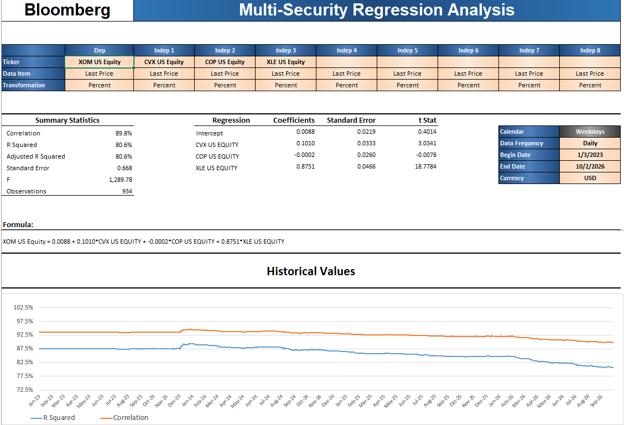
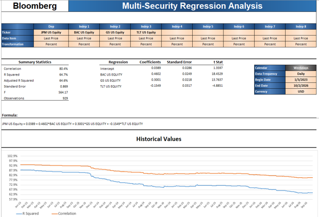

```{css, echo=FALSE}
#TOC::before {
  content: "Contenido";
  display: block;
  font-weight: bold;
  font-size: 1.3em;
  margin-bottom: 8px;
}
```

```{r, echo=FALSE}
htmltools::tags$script(htmltools::HTML(sprintf(
  "document.addEventListener('DOMContentLoaded', function(){var h=document.getElementById('header'); var i=document.createElement('img'); i.src='%s'; i.style.width='300px'; i.style.display='block'; i.style.marginBottom='15px'; h.insertBefore(i, h.firstChild);});",
  knitr::image_uri("logo_egade.png"))))
```

# Introducción

Esta actividad continúa el trabajo con la terminal de Bloomberg de la Actividad Tarea 4. En aquella actividad se cotejaron regresiones lineales simples (cada acción contra el S&P 500) entre Bloomberg y RStudio; en esta se cotejan las **regresiones lineales múltiples** de la Tarea 2, estimadas originalmente en RStudio, contra las mismas regresiones estimadas en Bloomberg.

Los modelos de la Tarea 2 explican el rendimiento diario de una acción con los rendimientos de otras acciones o ETF relacionados, uno por sector:

| Modelo | Sector | Variable dependiente | Variables independientes |
|---|---|---|---|
| mt101 | Energía | XOM | CVX, COP, XLE |
| mt101b | Energía | XOM | CVX, COP (versión corregida de mt101, sin XLE, por multicolinealidad) |
| mt102 | Financiero | JPM | BAC, GS, TLT |
| mt103 | Tecnología | AAPL | MSFT, NVDA, SPY |

Todos los modelos usan rendimientos diarios del 3 de enero de 2023 al 2 de octubre de 2026. El documento se organiza en dos partes:

- **Parte 1.** Se reestiman en RStudio los cuatro modelos de la Tarea 2 con los mismos datos y el mismo código, se presentan las regresiones obtenidas en Bloomberg y se comparan modelo por modelo, para identificar sus similitudes y diferencias.
- **Parte 2.** Se responden las preguntas 16.1 a 16.8 del capítulo 16 de Gujarati, "Modelos de regresión con datos de panel".

# Parte 1. Regresiones múltiples: Bloomberg vs. Tarea 2

En esta parte se comparan los cuatro modelos de regresión múltiple de la Tarea 2 en dos escenarios: estimados en RStudio con precios de Yahoo Finance, como en la tarea original, y estimados en Bloomberg con la plantilla *Multi-Security Regression Analysis*. Primero se reestiman los modelos en RStudio, después se explica cómo se obtuvieron en Bloomberg, luego se comparan modelo por modelo y, por último, se resumen sus similitudes y diferencias.

## 1.1 Modelos originales de la Tarea 2

Los modelos se reestiman con la misma metodología de la Tarea 2: se descargan de Yahoo Finance los precios de cierre diarios (*Close*) de las doce emisoras, se unen por fecha los precios de las emisoras de cada modelo, conservando solo las fechas con datos completos, y se calculan los rendimientos diarios como cambio porcentual simple, eliminando la primera observación, que no tiene rendimiento. El periodo es el mismo que se utilizó en Bloomberg: del 3 de enero de 2023 al 2 de octubre de 2026.

A diferencia de la Tarea 2, donde los rendimientos se expresaron en decimales (0.01 = 1%), aquí se multiplican por 100 para expresarlos en porcentaje, que es la escala que usa Bloomberg (*Percent*). Este cambio de escala no modifica las pendientes, sus errores estándar, los estadísticos t ni el $R^2$; solo multiplica por 100 el intercepto, su error estándar y el error estándar de la regresión.

Primero se descargan una sola vez los precios de las doce emisoras, y se define una función que arma la base de rendimientos de cada modelo. Cada modelo se estima después en su propia sección.

```{r datos-tarea2, message=FALSE, warning=FALSE}
library(quantmod)

# 1. Descargar los precios de cierre diarios de Yahoo Finance
emisoras <- c("XOM", "CVX", "COP", "XLE", "JPM", "BAC", "GS", "TLT",
              "AAPL", "MSFT", "NVDA", "SPY")
precios <- lapply(emisoras, function(e)
  Cl(na.omit(getSymbols(e, from = "2023-01-01", to = "2026-10-03", auto.assign = FALSE))))
names(precios) <- emisoras

# 2. Base de un modelo: unir por fecha, calcular rendimientos en % y quitar el primer día
base_modelo <- function(acciones) {
  base <- na.omit(do.call(merge, precios[acciones]))
  base <- base[index(base) <= as.Date("2026-10-02")]
  rend <- do.call(merge, lapply(1:ncol(base), function(j) dailyReturn(base[, j])))
  colnames(rend) <- tolower(paste0(acciones, "_r"))
  as.data.frame(rend[-1, ]) * 100
}
```

## 1.2 Regresiones en Bloomberg

La función HRA de Bloomberg, utilizada en la Actividad Tarea 4, solo estima regresiones simples (una variable independiente). Para las regresiones múltiples se utilizó la plantilla de Excel de Bloomberg *Multi-Security Regression Analysis*, que descarga los datos de la terminal y estima la regresión con hasta ocho variables independientes. Todas las capturas de las secciones siguientes tienen la misma estructura, por lo que se explica una sola vez:

- **Configuración (parte superior).** La fila *Ticker* indica la variable dependiente (*Dep*) y las independientes (*Indep 1* a *Indep 8*), con su identificador de Bloomberg (por ejemplo, *XOM US Equity*). Para todas se usa el precio de cierre (*Data Item: Last Price*) y la regresión se calcula sobre cambios porcentuales (*Transformation: Percent*), es decir, sobre rendimientos en porcentaje. En el recuadro de la derecha se definen la frecuencia diaria (*Daily*), el periodo (*Begin Date* 1/3/2023 y *End Date* 10/2/2026), el calendario (*Weekdays*, días hábiles de lunes a viernes) y la moneda.
- **Estadísticos del modelo (*Summary Statistics*).** Bloomberg reporta la correlación múltiple (*Correlation*, la raíz cuadrada del $R^2$), el $R^2$ (*R Squared*), el $R^2$ ajustado, el error estándar de la regresión (*Standard Error*), el estadístico F y el número de observaciones (*Observations*).
- **Coeficientes (*Regression*).** Para el intercepto y cada variable independiente se reportan el coeficiente (*Coefficients*), su error estándar (*Standard Error*) y su estadístico t (*t Stat*). A diferencia de RStudio, la plantilla no reporta el valor p, por lo que la significancia se evalúa con el estadístico t: en valor absoluto, un t mayor a 1.96 indica significancia al 5%.
- **Ecuación (*Formula*).** La ecuación estimada con los coeficientes.
- **Valores históricos (*Historical Values*).** Una gráfica con la evolución del $R^2$ y de la correlación a lo largo del periodo.

Los resultados de Bloomberg están en porcentaje, la misma escala de los modelos reestimados en la sección 1.1, por lo que pueden compararse directamente.

## 1.3 mt101: XOM ~ CVX + COP + XLE

**Base de datos.** El modelo mt101 explica el rendimiento diario de Exxon Mobil (XOM) con los de Chevron (CVX), ConocoPhillips (COP) y el ETF del sector energético (XLE). Su base se arma con la función de la sección 1.1.

```{r base-mt101}
mt101_df <- base_modelo(c("XOM", "CVX", "COP", "XLE"))

knitr::kable(data.frame(
  Observaciones = nrow(mt101_df),
  Primero = rownames(mt101_df)[1],
  Ultimo  = rownames(mt101_df)[nrow(mt101_df)]),
  col.names = c("Observaciones", "Primer rendimiento", "Último rendimiento"),
  caption = "Base de datos del modelo mt101")
```

**Regresión en RStudio.** Con esta base se reestima el modelo mt101 de la Tarea 2:

```{r modelo-mt101}
mt101 <- lm(xom_r ~ cvx_r + cop_r + xle_r, data = mt101_df)
summary(mt101)
```
La reestimación reproduce exactamente los resultados de la Tarea 2: las pendientes, sus errores estándar, los estadísticos t y el $R^2$ son idénticos, y el intercepto (0.0087) y el error estándar de la regresión (0.6669) son los de la Tarea 2 multiplicados por 100, por el cambio de escala explicado en la sección 1.1. Con 940 observaciones, XLE es la variable dominante (0.8803, t = 18.92), Chevron es significativa con un efecto menor (0.0985, t = 2.96), y ni ConocoPhillips (−0.0030, t = −0.12) ni el intercepto son significativos. El modelo explica el 80.5% de la variación del rendimiento diario de Exxon.

**Regresión en Bloomberg.** En la siguiente imagen se observa el mismo modelo estimado con la plantilla *Multi-Security Regression Analysis* de Bloomberg:

```{r bbg-mt101, echo=FALSE, out.width="95%"}

```

En Bloomberg, el ETF del sector (XLE) es la variable dominante: su coeficiente es de 0.8751, con un estadístico t de 18.78. Chevron también es significativa, aunque con un efecto mucho menor (0.1010, t = 3.03), mientras que ConocoPhillips tiene un coeficiente prácticamente igual a cero (−0.0002, t = −0.01) y no es significativa, igual que el intercepto (t = 0.40). El modelo explica el 80.6% de la variación del rendimiento diario de Exxon y utiliza 934 observaciones. En la gráfica de valores históricos se observa que el $R^2$ se mantuvo cerca de 87% durante 2023 y bajó gradualmente hasta el 80.6% del periodo completo.

**Comparación.** Para comparar ambos resultados de forma objetiva, se crea una función que coloca, estadístico por estadístico, los valores de Bloomberg junto a los de RStudio y calcula su diferencia. Los valores de Bloomberg se toman de la captura anterior; los de RStudio, directamente del modelo. La misma función se utiliza en las secciones 1.4 a 1.6.

```{r funcion-cotejo-mult}
cotejo_mult <- function(modelo, bbg, titulo) {
  s  <- summary(modelo)
  cf <- coef(s)
  vars <- c("Intercepto", toupper(sub("_r$", "", rownames(cf)[-1])))
  etiquetas <- c(as.vector(t(outer(vars, c("coeficiente", "error estándar", "t"), paste))),
                 "R²", "R² ajustado", "Error estándar de la regresión", "F", "Observaciones")
  r  <- c(as.vector(t(cf[, 1:3])), s$r.squared, s$adj.r.squared, s$sigma,
          unname(s$fstatistic[1]), nobs(modelo))
  dec <- c(rep(4, length(r) - 2), 2, 0)
  fmt <- function(v) mapply(function(x, d) formatC(x, format = "f", digits = d, big.mark = ","), v, dec)
  knitr::kable(data.frame(Estadistico = etiquetas, Bloomberg = fmt(bbg), RStudio = fmt(r),
                          Diferencia = fmt(ifelse(abs(r - bbg) < 0.00005, 0, r - bbg))),
               row.names = FALSE, align = c("l", "r", "r", "r"), caption = titulo,
               col.names = c("Estadístico", "Bloomberg", "RStudio", "Diferencia (RStudio − Bloomberg)"))
}
```

La siguiente tabla compara ambos resultados del modelo mt101:

```{r cotejo-mt101}
cotejo_mult(mt101,
            bbg = c(0.0088, 0.0219, 0.4014,     # Intercepto
                    0.1010, 0.0333, 3.0341,     # CVX
                    -0.0002, 0.0260, -0.0076,   # COP
                    0.8751, 0.0466, 18.7784,    # XLE
                    0.806, 0.806, 0.668, 1289.78, 934),
            titulo = "Cotejo del modelo mt101: Bloomberg vs. RStudio")
```

**Resultado de la comparación:** los resultados de Bloomberg y RStudio son muy parecidos, pero no idénticos. Todos los coeficientes tienen el mismo signo y llevan a las mismas conclusiones: XLE es la variable dominante, Chevron es significativa y ConocoPhillips no lo es. Las diferencias en los coeficientes son pequeñas, de 0.0052 como máximo (XLE), y los errores estándar prácticamente coinciden. La diferencia principal está en el número de observaciones: Bloomberg utilizó 934 días y RStudio 940, es decir, 6 menos. Al estimar el modelo con una muestra ligeramente distinta, los coeficientes cambian un poco. Las posibles causas de esta diferencia se analizan en la sección 1.7.

## 1.4 mt101b: XOM ~ CVX + COP

**Base de datos.** El modelo mt101b es la versión corregida de mt101: en la Tarea 2 se eliminó XLE por su multicolinealidad con las demás variables, y se conservaron Chevron (CVX) y ConocoPhillips (COP) como variables independientes. Utiliza la misma base de datos de mt101 (sección 1.3), con 940 observaciones del 4 de enero de 2023 al 2 de octubre de 2026.

**Regresión en RStudio.** Con esta base se reestima el modelo mt101b de la Tarea 2:

```{r modelo-mt101b}
mt101b <- lm(xom_r ~ cvx_r + cop_r, data = mt101_df)
summary(mt101b)
```

La reestimación reproduce los resultados de la Tarea 2, con el intercepto y el error estándar de la regresión multiplicados por 100. Sin XLE, las dos variables restantes son significativas y tienen el signo positivo esperado: Chevron (0.5232, t = 18.15) y ConocoPhillips (0.3251, t = 14.37). El intercepto no es significativo (t = 1.28). El modelo explica el 73.0% de la variación del rendimiento diario de Exxon, menos que mt101 (80.5%), porque deja de incluir al ETF del sector.

**Regresión en Bloomberg.** En la siguiente imagen se observa el mismo modelo estimado en Bloomberg:

```{r bbg-mt101b, echo=FALSE, out.width="95%"}

```

En Bloomberg, Chevron (0.5232, t = 18.13) y ConocoPhillips (0.3259, t = 14.39) también son significativas y positivas, y el intercepto no lo es (t = 1.26). El modelo explica el 73.1% de la variación del rendimiento diario de Exxon y utiliza 938 observaciones. En la gráfica de valores históricos, el $R^2$ se mantuvo cerca de 77% durante 2023, subió a cerca de 80% a inicios de 2024 y bajó gradualmente hasta el 73.1% del periodo completo.

**Comparación.** La siguiente tabla compara ambos resultados del modelo mt101b, con la función de la sección 1.3:

```{r cotejo-mt101b}
cotejo_mult(mt101b,
            bbg = c(0.0322, 0.0256, 1.2576,     # Intercepto
                    0.5232, 0.0289, 18.1307,    # CVX
                    0.3259, 0.0227, 14.3892,    # COP
                    0.731, 0.731, 0.785, 1271.21, 938),
            titulo = "Cotejo del modelo mt101b: Bloomberg vs. RStudio")
```

**Resultado de la comparación:** mt101b es el modelo en el que Bloomberg y RStudio más se acercan. El coeficiente de Chevron coincide prácticamente a cuatro decimales (0.5232 en ambos), y el de ConocoPhillips difiere apenas en 0.0008. Los errores estándar difieren en 0.0001 como máximo, y las conclusiones son las mismas: las dos variables son significativas y positivas, y el intercepto no lo es. Es también el modelo con menor diferencia en observaciones: Bloomberg utilizó 938 días y RStudio 940, solo 2 menos. Al comparar con mt101, que tuvo 6 observaciones de diferencia, se observa que una muestra más parecida tiende a producir resultados más parecidos; la sección 1.7 analiza si esta relación se cumple en los cuatro modelos.

## 1.5 mt102: JPM ~ BAC + GS + TLT

**Base de datos.** El modelo mt102 explica el rendimiento diario de JPMorgan (JPM) con los de Bank of America (BAC), Goldman Sachs (GS) y el ETF de bonos del Tesoro de largo plazo (TLT). Su base se arma con la función de la sección 1.1.

```{r base-mt102}
mt102_df <- base_modelo(c("JPM", "BAC", "GS", "TLT"))

knitr::kable(data.frame(
  Observaciones = nrow(mt102_df),
  Primero = rownames(mt102_df)[1],
  Ultimo  = rownames(mt102_df)[nrow(mt102_df)]),
  col.names = c("Observaciones", "Primer rendimiento", "Último rendimiento"),
  caption = "Base de datos del modelo mt102")
```

**Regresión en RStudio.** Con esta base se reestima el modelo mt102 de la Tarea 2:

```{r modelo-mt102}
mt102 <- lm(jpm_r ~ bac_r + gs_r + tlt_r, data = mt102_df)
summary(mt102)
```

La reestimación reproduce los resultados de la Tarea 2, con el intercepto y el error estándar de la regresión multiplicados por 100. Las tres variables son significativas y tienen el signo esperado: Bank of America (0.4551, t = 18.54) y Goldman Sachs (0.3050, t = 14.25) con signo positivo, y TLT (−0.1580, t = −5.02) con signo negativo, es decir, JPMorgan tiende a subir cuando bajan los precios de los bonos de largo plazo. El intercepto no es significativo (t = 1.35). El modelo explica el 65.0% de la variación del rendimiento diario de JPMorgan.

**Regresión en Bloomberg.** En la siguiente imagen se observa el mismo modelo estimado en Bloomberg:

```{r bbg-mt102, echo=FALSE, out.width="95%"}

```

En Bloomberg, las tres variables también son significativas y con el mismo signo: Bank of America (0.4602, t = 18.45), Goldman Sachs (0.3001, t = 13.76) y TLT (−0.1549, t = −4.89). El intercepto no es significativo (t = 1.36). El modelo explica el 64.7% de la variación del rendimiento diario de JPMorgan y utiliza 929 observaciones. En la gráfica de valores históricos se observa la caída más pronunciada de los cuatro modelos: el $R^2$ empezó cerca de 88% en 2023, bajó con fuerza a finales de ese año y continuó descendiendo hasta el 64.7% del periodo completo.

**Comparación.** La siguiente tabla compara ambos resultados del modelo mt102:

```{r cotejo-mt102}
cotejo_mult(mt102,
            bbg = c(0.0389, 0.0286, 1.3597,     # Intercepto
                    0.4602, 0.0249, 18.4529,    # BAC
                    0.3001, 0.0218, 13.7637,    # GS
                    -0.1549, 0.0317, -4.8851,   # TLT
                    0.647, 0.646, 0.869, 564.17, 929),
            titulo = "Cotejo del modelo mt102: Bloomberg vs. RStudio")
```

**Resultado de la comparación:** las conclusiones vuelven a ser las mismas en ambas herramientas: las tres variables son significativas, con el mismo signo, y el intercepto no lo es. Sin embargo, mt102 es el modelo con mayores diferencias en proporción a la precisión de sus estimaciones. La diferencia en el coeficiente de Goldman Sachs (0.0049) equivale a 0.23 veces su error estándar, la mayor de los cuatro modelos; el estadístico t de esta variable es casi medio punto mayor en RStudio (14.25 contra 13.76), el error estándar de la regresión es 0.0098 menor y el estadístico F es 15 puntos mayor. También es el modelo con mayor diferencia en observaciones: Bloomberg utilizó 929 días y RStudio 940, es decir, 11 menos.

## 1.6 mt103: AAPL ~ MSFT + NVDA + SPY

**Base de datos.** El modelo mt103 explica el rendimiento diario de Apple (AAPL) con los de Microsoft (MSFT), Nvidia (NVDA) y el ETF del S&P 500 (SPY), que representa el factor de mercado. Su base se arma con la función de la sección 1.1.

```{r base-mt103}
mt103_df <- base_modelo(c("AAPL", "MSFT", "NVDA", "SPY"))

knitr::kable(data.frame(
  Observaciones = nrow(mt103_df),
  Primero = rownames(mt103_df)[1],
  Ultimo  = rownames(mt103_df)[nrow(mt103_df)]),
  col.names = c("Observaciones", "Primer rendimiento", "Último rendimiento"),
  caption = "Base de datos del modelo mt103")
```

**Regresión en RStudio.** Con esta base se reestima el modelo mt103 de la Tarea 2:

```{r modelo-mt103}
mt103 <- lm(aapl_r ~ msft_r + nvda_r + spy_r, data = mt103_df)
summary(mt103)
```

La reestimación reproduce los resultados de la Tarea 2, con el intercepto y el error estándar de la regresión multiplicados por 100. El mercado es la variable dominante: por cada punto porcentual que sube SPY, Apple sube en promedio 1.17 puntos (t = 18.61). Nvidia es significativa, pero con signo negativo (−0.0718, t = −4.02): una vez que se controla por el mercado, Apple tiende a moverse ligeramente en sentido contrario a Nvidia. Microsoft no es significativa (0.0461, t = 1.50), al igual que el intercepto (t = 1.08). El modelo explica el 39.5% de la variación del rendimiento diario de Apple, el menor de los cuatro modelos.

**Regresión en Bloomberg.** En la siguiente imagen se observa el mismo modelo estimado en Bloomberg:

```{r bbg-mt103, echo=FALSE, out.width="95%"}

```

En Bloomberg, SPY también es la variable dominante (1.1750, t = 18.57), Nvidia es significativa con signo negativo (−0.0712, t = −3.96), y ni Microsoft (0.0440, t = 1.42) ni el intercepto (t = 0.98) son significativos. El modelo explica el 39.5% de la variación del rendimiento diario de Apple y utiliza 937 observaciones. En la gráfica de valores históricos, el $R^2$ empezó cerca de 70% en 2023, bajó a alrededor de 60% durante 2024 y 2025, y cayó con fuerza en 2026 hasta el 39.5% del periodo completo.

**Comparación.** La siguiente tabla compara ambos resultados del modelo mt103:

```{r cotejo-mt103}
cotejo_mult(mt103,
            bbg = c(0.0411, 0.0418, 0.9828,     # Intercepto
                    0.0440, 0.0309, 1.4226,     # MSFT
                    -0.0712, 0.0180, -3.9591,   # NVDA
                    1.1750, 0.0633, 18.5702,    # SPY
                    0.395, 0.394, 1.273, 202.80, 937),
            titulo = "Cotejo del modelo mt103: Bloomberg vs. RStudio")
```

**Resultado de la comparación:** las conclusiones son las mismas en ambas herramientas: SPY es la variable dominante, Nvidia es significativa con signo negativo, y ni Microsoft ni el intercepto son significativos. El $R^2$ prácticamente coincide (0.395 en ambos). Bloomberg utilizó 937 observaciones y RStudio 940, solo 3 menos. La diferencia en el coeficiente de SPY (0.0056) es ligeramente mayor en valor absoluto que la de XLE en mt101 (0.0052), que tuvo 6 observaciones de diferencia, pero el coeficiente de SPY es también mucho mayor (1.17). Medida en unidades de su error estándar, la diferencia en mt103 (0.09) es menor que la de mt101 (0.11), lo que es consistente con su menor diferencia en observaciones.

## 1.7 Similitudes y diferencias

Una vez comparados los cuatro modelos, en esta sección se resumen sus resultados y se analizan las causas de las diferencias. Para la tabla resumen se toman de las secciones 1.3 a 1.6 las pendientes, los estadísticos t, el $R^2$ y las observaciones de Bloomberg, y se comparan con los modelos de RStudio. Como los coeficientes tienen magnitudes muy distintas (por ejemplo, 1.17 para SPY y casi cero para COP), su diferencia se mide también en unidades de su error estándar, que indica qué tan grande es la diferencia en relación con la precisión de la estimación.

```{r resumen-comparacion}
bbg_res <- list(
  mt101  = list(coef = c(0.1010, -0.0002, 0.8751),  t = c(3.0341, -0.0076, 18.7784),  r2 = 0.806, n = 934),
  mt101b = list(coef = c(0.5232, 0.3259),           t = c(18.1307, 14.3892),          r2 = 0.731, n = 938),
  mt102  = list(coef = c(0.4602, 0.3001, -0.1549),  t = c(18.4529, 13.7637, -4.8851), r2 = 0.647, n = 929),
  mt103  = list(coef = c(0.0440, -0.0712, 1.1750),  t = c(1.4226, -3.9591, 18.5702),  r2 = 0.395, n = 937))
mods_r <- list(mt101 = mt101, mt101b = mt101b, mt102 = mt102, mt103 = mt103)

resumen_comp <- do.call(rbind, lapply(names(mods_r), function(m) {
  cf <- coef(summary(mods_r[[m]]))[-1, ]
  b  <- bbg_res[[m]]
  data.frame(Modelo   = m,
             Obs_BBG  = b$n,
             Obs_R    = nobs(mods_r[[m]]),
             Dias     = nobs(mods_r[[m]]) - b$n,
             R2_BBG   = b$r2,
             R2_R     = summary(mods_r[[m]])$r.squared,
             Dif_max  = max(abs(cf[, 1] - b$coef)),
             Dif_ee   = max(abs(cf[, 1] - b$coef) / cf[, 2]),
             Iguales  = ifelse(all(sign(cf[, 1]) == sign(b$coef)) &&
                               all((abs(cf[, 3]) > 1.96) == (abs(b$t) > 1.96)), "Sí", "No"))
}))
resumen_comp <- resumen_comp[order(resumen_comp$Dias), ]

knitr::kable(resumen_comp, digits = c(0, 0, 0, 0, 3, 3, 4, 2, 0), row.names = FALSE,
             col.names = c("Modelo", "Obs. Bloomberg", "Obs. RStudio", "Días de diferencia",
                           "R² Bloomberg", "R² RStudio", "Dif. máxima en coeficientes",
                           "Dif. máxima en errores estándar", "Mismos signos y significancia"),
             caption = "Resumen de la comparación Bloomberg vs. RStudio (ordenado por días de diferencia)")
```

La tabla, ordenada de menor a mayor diferencia en observaciones, permite identificar las similitudes y diferencias entre ambas herramientas.

**Similitudes.** En los cuatro modelos, las trece pendientes estimadas tienen el mismo signo y la misma significancia al 5% en Bloomberg y en RStudio, por lo que las conclusiones económicas de la Tarea 2 se mantienen: el ETF sectorial domina en mt101, los competidores directos explican a Exxon en mt101b, los bancos y los bonos explican a JPMorgan en mt102, y el mercado domina en mt103. El $R^2$ difiere en 0.003 como máximo, y los errores estándar de los coeficientes prácticamente coinciden.

**Diferencias.** Ningún modelo coincide exactamente, a diferencia de las regresiones simples de la Actividad Tarea 4, en las que Bloomberg y RStudio coincidieron a tres decimales. RStudio utilizó 940 observaciones en los cuatro modelos, mientras que Bloomberg utilizó entre 929 y 938. Las diferencias en los coeficientes son pequeñas, de 0.0056 como máximo, y equivalen a menos de una cuarta parte de su error estándar, muy lejos del tamaño que cambiaría la significancia de alguna variable.

**Causas de las diferencias.** La causa principal es el número de observaciones, por tres razones:

1. **La diferencia en los resultados crece con la diferencia en la muestra.** Medida en errores estándar, la diferencia máxima en los coeficientes aumenta en el mismo orden que los días de diferencia: 0.03 en mt101b (2 días), 0.09 en mt103 (3 días), 0.11 en mt101 (6 días) y 0.23 en mt102 (11 días).
2. **Los días que pierde Bloomberg dependen de los activos de cada modelo.** mt101 y mt101b usan la misma base en RStudio, y la única diferencia entre ellos es XLE; sin embargo, Bloomberg utilizó 934 días en mt101 y 938 en mt101b. Los 4 días adicionales que se pierden en mt101 se deben, por tanto, a XLE. Si la causa fueran solo los días festivos del mercado, todos los modelos perderían los mismos días.
3. **La configuración de la plantilla.** Bloomberg utilizó el calendario *Weekdays* (días hábiles de lunes a viernes) en lugar del calendario de operación del mercado. Es probable que, con este calendario, los días en que alguna serie no tiene precio en Bloomberg se excluyan de la regresión. No fue posible confirmarlo, porque para hacerlo se requiere revisar en la terminal los datos de Bloomberg día por día.

Hay además dos causas secundarias. Los precios provienen de fuentes distintas (*Close* de Yahoo Finance en RStudio y *Last Price* en Bloomberg), y aunque en la Actividad Tarea 4 Bloomberg y LSEG coincidieron exactamente, no se verificó día por día que Yahoo Finance coincida con Bloomberg. Por último, la plantilla de Bloomberg muestra el $R^2$ con un solo decimal en porcentaje (por ejemplo, 80.6%), por lo que parte de las diferencias en el $R^2$ se debe al redondeo de la captura.

**Valores históricos.** La gráfica de valores históricos de Bloomberg, que no tiene equivalente en el análisis de la Tarea 2, muestra que el $R^2$ de los cuatro modelos disminuyó a lo largo del periodo, con mayor fuerza en mt102 (de cerca de 88% a 64.7%) y en mt103 (de cerca de 70% a 39.5%). Las relaciones entre las acciones y sus variables explicativas se debilitaron con el tiempo, lo que es consistente con el efecto del periodo observado en la sección 3.11 de la Actividad Tarea 4: un mismo modelo puede tener un poder explicativo muy distinto según el periodo en que se estima.

**Conclusión.** Bloomberg y RStudio llevan a las mismas conclusiones en los cuatro modelos, y sus diferencias se explican principalmente por las observaciones que utiliza cada herramienta. Cada una tiene ventajas propias: la plantilla de Bloomberg es rápida y muestra la evolución del ajuste en el tiempo, pero no reporta valores p ni permite revisar los supuestos del modelo; RStudio, en cambio, permite reproducir el análisis completo y aplicar las pruebas de multicolinealidad y heterocedasticidad de la Tarea 2. La principal lección práctica es que, para replicar un resultado entre herramientas, no basta con usar las mismas variables y fechas: hay que verificar también que ambas utilicen exactamente las mismas observaciones, revisando su número y la configuración del calendario.

# Parte 2. Preguntas del capítulo 16 de Gujarati (16.1 a 16.8)

En esta parte se responden las preguntas 16.1 a 16.8 del capítulo 16 de Gujarati y Porter, *Econometría* (5a. edición), "Modelos de regresión con datos de panel". Para hacer concretas las respuestas, se ilustran con los datos de la Parte 1: los rendimientos diarios de 12 series (nueve acciones y tres ETF) del 4 de enero de 2023 al 2 de octubre de 2026, con 940 observaciones cada una.

**16.1 ¿Cuáles son las características especiales de a) los datos de corte transversal, b) las series de tiempo y c) los datos de panel?**

a) **Datos de corte transversal.** Son observaciones de varias unidades (individuos, empresas, países) en un mismo momento. Su característica principal es la heterogeneidad entre unidades: cada una puede tener un tamaño o un comportamiento muy distinto, lo que suele provocar problemas de heteroscedasticidad. En esta actividad, un corte transversal serían los rendimientos de las 12 series en un solo día.

b) **Series de tiempo.** Son observaciones de una sola unidad a lo largo del tiempo. Sus características principales son que las observaciones suelen depender de las anteriores (autocorrelación), que la serie puede no ser estacionaria y que su comportamiento puede cambiar entre periodos. Cada modelo de la Parte 1 es un modelo de series de tiempo: por ejemplo, mt101 explica los 940 rendimientos diarios de XOM con los de CVX, COP y XLE. La gráfica de valores históricos de Bloomberg (sección 1.7) muestra uno de estos problemas: el $R^2$ de los cuatro modelos disminuyó a lo largo del periodo, es decir, la relación entre las variables cambió con el tiempo.

c) **Datos de panel.** Combinan ambas dimensiones: las mismas unidades se observan a lo largo del tiempo. Los datos de esta actividad forman un panel de 12 series × 940 días = 11,280 observaciones, y sería un panel balanceado, porque las cuatro bases de la sección 1.1 tienen el mismo número de días y las mismas fechas de inicio y fin. De acuerdo con Gujarati, los datos de panel permiten tomar en cuenta la heterogeneidad entre unidades, ofrecen más observaciones, más variabilidad y más grados de libertad, y son más adecuados para estudiar la dinámica del cambio. A cambio, combinan los problemas de ambos tipos de datos: heteroscedasticidad entre unidades, autocorrelación en el tiempo y, además, correlación entre unidades en un mismo momento. Esta última es muy clara en esta actividad: en mt101b, los rendimientos de CVX y COP explican cerca del 73% de la variación diaria de los de XOM, porque las acciones de un mismo sector se mueven juntas el mismo día.

**16.2 ¿Qué se quiere dar a entender con modelo de efectos fijos (MEF)? Como los datos de panel presentan las dos dimensiones de tiempo y espacio, ¿cómo es que el MEF permite ambas dimensiones?**

El modelo de efectos fijos permite que el intercepto sea distinto para cada unidad, para reconocer que cada una tiene características propias que no se observan. Se llama "fijo" porque el intercepto de cada unidad no cambia con el tiempo. Las pendientes, en cambio, se suponen iguales para todas las unidades. Aplicado a esta actividad, un MEF con las acciones como unidades y el SPY como variable explicativa sería:

$$R_{it} = \alpha_i + \beta \, R_{SPY,t} + u_{it}$$

donde $R_{it}$ es el rendimiento de la acción $i$ en el día $t$, $\alpha_i$ es el intercepto propio de cada acción y $\beta$ es una pendiente contra el SPY común a todas. En la práctica, el intercepto de cada unidad se introduce con variables dicótomas (una por acción, menos una para evitar la trampa de las variables dicótomas).

El MEF permite ambas dimensiones porque, además de las variables dicótomas por unidad (efecto individual), pueden incluirse variables dicótomas por periodo (efecto temporal), que recogen factores que afectan a todas las unidades en un mismo momento. Esta actividad muestra un límite de esa opción: el rendimiento del SPY es el mismo para todas las acciones en un día dado, por lo que un conjunto completo de variables dicótomas por día sería perfectamente colineal con él, y el modelo no podría estimar su pendiente. Además, la Parte 1 muestra que el supuesto de pendientes comunes no se cumple en estos datos: cada acción dependiente se explica con variables distintas (el ETF del sector en mt101, sus competidores en mt101b, los bancos y los bonos en mt102 y el mercado en mt103), con pendientes muy diferentes entre sí.

**16.3 ¿Qué se quiere dar a entender con modelo con componentes del error (MCE)? ¿En qué difiere del MEF? ¿Cuándo resulta apropiado el MCE, y cuándo el MEF?**

En el modelo con componentes del error, también llamado modelo de efectos aleatorios, el intercepto de cada unidad no se trata como un parámetro fijo, sino como una variable aleatoria alrededor de una media común: $\beta_{1i} = \beta_1 + \varepsilon_i$. La diferencia individual $\varepsilon_i$ pasa a formar parte del término de error, que se compone de dos partes: $w_{it} = \varepsilon_i + u_{it}$. La idea es que las unidades de la muestra provienen de una población más grande que comparte un intercepto promedio.

Las diferencias con el MEF son dos. Primero, el MEF estima un intercepto para cada unidad (con la consecuente pérdida de grados de libertad), mientras que el MCE solo estima el intercepto promedio y la varianza de $\varepsilon_i$. Segundo, y más importante, el MCE requiere que el componente individual $\varepsilon_i$ no esté correlacionado con las variables explicativas; el MEF no lo requiere.

De acuerdo con Gujarati, el MCE es apropiado cuando las unidades son una muestra aleatoria de una población más grande y su componente individual no está correlacionado con las variables explicativas; el MEF lo es cuando sí existe esa correlación o cuando las unidades no son una muestra aleatoria. Si el número de periodos es grande y el de unidades pequeño, la diferencia entre ambos suele ser pequeña. Formalmente, la elección se hace con la prueba de Hausman: si se rechaza la hipótesis nula de que no hay diferencia entre ambos estimadores, se prefiere el MEF. En esta actividad, las 12 series no son una muestra aleatoria del mercado: se eligieron deliberadamente en la Tarea 2 por su sector y por su relación con cada acción dependiente. Además, el panel tiene pocas unidades (12) y muchos periodos (940). Por ambas razones, el MEF sería el más adecuado.

**16.4 ¿Hay diferencia entre los modelos de mínimos cuadrados con variables dicótomas (MCVD), estimados dentro de grupos y primeras diferencias?**

Los tres son formas de estimar un modelo de efectos fijos, es decir, de controlar las características propias de cada unidad que no cambian con el tiempo. Difieren en cómo lo hacen:

- **MCVD:** incluye una variable dicótoma por unidad y estima directamente el intercepto de cada una. Su desventaja es que pierde un grado de libertad por cada variable dicótoma, lo que importa cuando hay muchas unidades.
- **Estimador dentro de grupos (DG):** a cada variable le resta su promedio por unidad, con lo que el efecto fijo desaparece. Las pendientes son las mismas que las de MCVD, pero el intercepto de cada unidad no se estima directamente. En esta actividad equivaldría a restar a los rendimientos de cada serie su rendimiento diario promedio del periodo.
- **Primeras diferencias:** a cada observación le resta la del periodo anterior de la misma unidad, lo que también elimina el efecto fijo. Cada unidad pierde su primera observación. La idea es parecida a la del paso de precios a rendimientos en la sección 1.1, en el que cada serie pasó de 941 precios a 940 rendimientos. Si el error original no está autocorrelacionado, el error en diferencias sí lo está.

Tanto el estimador dentro de grupos como el de primeras diferencias eliminan, junto con el efecto fijo, cualquier variable explicativa que no cambie con el tiempo. Además, según Gujarati, los estimadores de primeras diferencias y de efectos fijos coinciden cuando solo hay dos periodos, pero difieren cuando hay más. Con 940 días por serie, en esta actividad los resultados de primeras diferencias no coincidirían con los de MCVD y dentro de grupos.

**16.5 ¿Cuándo resultan inapropiados los modelos de regresión con datos de panel? Proporcione ejemplos.**

Como advierte Gujarati, citando a Johnston y DiNardo, los datos de panel "no son una cura milagrosa". Resultan inapropiados, o al menos deben usarse con cuidado, en los siguientes casos:

- **Cuando las pendientes son distintas entre unidades.** Los modelos de efectos fijos y de componentes del error permiten que cambie el intercepto, pero suponen la misma pendiente para todas las unidades. Si cada unidad responde de forma distinta a las variables explicativas, un panel con pendientes comunes produce un promedio que no describe a ninguna. Es el caso de esta actividad: en la Parte 1, XLE tiene una pendiente de 0.88 sobre XOM, mientras que TLT tiene una de −0.16 sobre JPM; en la Actividad Tarea 4, las betas contra el S&P 500 iban de −0.177 (USO) a 1.947 (NVDA). Aquí son más adecuadas regresiones separadas para cada acción, como las de la Parte 1.
- **Cuando hay pocas unidades y muchos periodos.** Con pocas unidades se pierde la principal ventaja del panel, que es aprovechar la variación entre ellas, y cada unidad tiene suficientes observaciones para estimarse por separado. Con 940 días por serie, cada modelo de la Parte 1 tiene observaciones de sobra para estimarse solo.
- **Cuando la variable de interés no cambia con el tiempo y se usa el MEF.** El efecto fijo absorbe cualquier característica constante de cada unidad, por lo que su efecto no puede estimarse. Por ejemplo, en un panel de acciones no podría estimarse el efecto del sector de cada empresa, porque ese sector no cambia en el periodo.
- **Cuando hay correlación fuerte entre unidades en un mismo momento.** Los modelos de panel básicos suponen que los errores de distintas unidades son independientes. En los mercados financieros esto rara vez se cumple: las acciones de un mismo sector reaccionan juntas a las mismas noticias, como XOM y CVX en esta actividad, lo que hace que los errores estándar convencionales subestimen la incertidumbre.
- **Cuando hay desgaste (*attrition*) en el panel.** Si las unidades salen del panel por razones relacionadas con la variable estudiada, la muestra deja de ser representativa. Por ejemplo, en un panel de acciones de varios años, las empresas que dejan de cotizar por quiebra o adquisición desaparecen, y el panel queda formado solo por las sobrevivientes, cuyos rendimientos tienden a ser mejores.

Además, Gujarati señala que hay temas que los modelos básicos del capítulo no cubren, como la heteroscedasticidad y la autocorrelación en el MCE, los paneles no balanceados, los paneles dinámicos (con la variable dependiente rezagada como explicativa) y las raíces unitarias, que se estudian en el capítulo 21. Cuando los datos presentan estos problemas, el modelo de panel básico no es suficiente.

**16.6 ¿Cómo ampliaría el modelo (16.4.2) para incluir un componente del error en el tiempo? Escriba el modelo explícitamente.**

El modelo (16.4.2) es un modelo de efectos fijos para seis aerolíneas de 1970 a 1984, en el que el costo total ($C$) se explica con la producción ($Q$), el precio del combustible ($PF$) y el factor de carga ($LF$), y la aerolínea se recoge con cinco variables dicótomas:

$$C_{it} = \alpha_1 + \alpha_2 D_{2i} + \alpha_3 D_{3i} + \alpha_4 D_{4i} + \alpha_5 D_{5i} + \alpha_6 D_{6i} + \beta_2 Q_{it} + \beta_3 PF_{it} + \beta_4 LF_{it} + u_{it}$$

Este modelo solo toma en cuenta las diferencias entre aerolíneas. Para incluir también un componente en el tiempo, que recoja factores que afectan a todas las aerolíneas en un mismo año (por ejemplo, un cambio en la regulación o una recesión), hay dos formas.

**a) Como efecto fijo en el tiempo.** Se agrega una variable dicótoma por año, excepto el primero, que queda como año de referencia:

$$C_{it} = \alpha_1 + \sum_{j=2}^{6} \alpha_j D_{ji} + \sum_{t=1971}^{1984} \lambda_t \, Dum_t + \beta_2 Q_{it} + \beta_3 PF_{it} + \beta_4 LF_{it} + u_{it}$$

donde $Dum_t$ vale 1 en el año $t$ y 0 en los demás. Es el modelo de efectos fijos en dos sentidos (aerolínea y tiempo). Tiene 23 coeficientes: el intercepto, 5 variables dicótomas por aerolínea, 14 por año y 3 pendientes, con 90 observaciones.

**b) Como componente del error.** Si los efectos de aerolínea y de año se tratan como aleatorios, ambos pasan al término de error:

$$C_{it} = \beta_1 + \beta_2 Q_{it} + \beta_3 PF_{it} + \beta_4 LF_{it} + w_{it}, \qquad w_{it} = \varepsilon_i + \lambda_t + u_{it}$$

donde $\varepsilon_i$ es el componente propio de cada aerolínea, $\lambda_t$ el componente propio de cada año y $u_{it}$ el error que combina ambas dimensiones. Se supone que los tres tienen media cero, no están correlacionados entre sí y no están correlacionados con $Q$, $PF$ y $LF$. Este modelo estima solo cuatro coeficientes y las tres varianzas del error, en lugar de 23 coeficientes. Como la pregunta pide un componente del error, esta segunda forma es la que responde a ella de manera más directa.

**16.7 Consulte el ejemplo de los huevos y sus precios de la tabla 1.1. ¿Qué modelo resultaría apropiado en este caso, el MEF o el MCE? ¿Por qué?**

La tabla 1.1 de Gujarati (capítulo 1, p. 24) presenta la producción de huevos y su precio en los 50 estados de Estados Unidos, con las siguientes variables:

| Variable | Descripción |
|---|---|
| Y1 | Huevos producidos en 1990 (millones) |
| Y2 | Huevos producidos en 1991 (millones) |
| X1 | Precio por docena en 1990 (centavos de dólar) |
| X2 | Precio por docena en 1991 (centavos de dólar) |

Fuente: *World Almanac*, 1993, p. 119, con datos del Economic Research Service del Departamento de Agricultura de Estados Unidos.

Como la tabla solo incluye 1990 y 1991, los datos forman un panel de 50 unidades y 2 periodos (100 observaciones). El modelo más adecuado es el MEF, por dos razones:

- **Los 50 estados no son una muestra aleatoria.** Son la totalidad de los estados, no una muestra extraída de una población más grande. Gujarati indica que, cuando el número de unidades es grande, el de periodos pequeño y las unidades no son extracciones aleatorias de una población más grande, el MEF es el apropiado. Es exactamente este caso.
- **Es probable que el efecto de cada estado esté correlacionado con el precio.** Cada estado tiene características propias que no cambian entre 1990 y 1991 (el tamaño de su industria avícola, sus costos de producción, su cercanía con los mercados), y esas mismas características influyen en el precio del huevo en ese estado. Si es así, el MCE estaría sesgado y el MEF no.

El MEF tiene un costo en este caso: con solo dos años, las 49 variables dicótomas por estado consumen casi la mitad de las 100 observaciones. Por eso, con dos periodos conviene estimarlo por primeras diferencias, que, como se vio en la pregunta 16.4, da el mismo resultado que el MEF. Para confirmar la elección se aplicaría la prueba de Hausman.

**16.8 Para los datos de inversión presentados en la tabla 1.2, ¿qué modelo debe elegirse, MEF o MEFA? ¿Por qué?**

La tabla 1.2 de Gujarati (capítulo 1, p. 26) presenta los datos de inversión recopilados originalmente por Y. Grunfeld para cuatro empresas de Estados Unidos: General Electric (GE), U.S. Steel (US), General Motors (GM) y Westinghouse (WEST), de 1935 a 1954. Para cada empresa y cada año incluye las siguientes variables:

| Variable | Descripción |
|---|---|
| $I$ | Inversión bruta real |
| $F_{-1}$ | Valor real de la empresa un año antes |
| $C_{-1}$ | Capital accionario real un año antes |

El propósito de Grunfeld era investigar cómo depende la inversión del valor de la empresa y de su capital accionario del año anterior. Como cada empresa tiene 20 años de datos, la tabla forma un panel balanceado de 4 unidades y 20 periodos (80 observaciones). Elegiría el MEF, por tres razones:

- **Las cuatro empresas no son una muestra aleatoria.** Son empresas específicas, elegidas por su importancia, y el interés está en ellas y no en una población más grande de empresas.
- **Es probable que el efecto de cada empresa esté correlacionado con las variables explicativas.** Las características propias de cada empresa, como su tamaño, su sector o su forma de administrar, influyen tanto en su inversión como en su valor y su capital accionario. En ese caso, el MEFA estaría sesgado.
- **Hay pocas unidades y relativamente más periodos.** Gujarati indica que, cuando el número de periodos es grande y el de unidades pequeño, la diferencia entre ambos estimadores suele ser pequeña, y el MEF es más conveniente. Además, el MEFA tendría que estimar la varianza del componente individual con solo cuatro empresas, lo que haría esa estimación poco precisa.

Esta situación es parecida a la de esta actividad, con pocas unidades elegidas deliberadamente (12) y muchos periodos (940). Como en la pregunta anterior, la elección se confirmaría con la prueba de Hausman.
